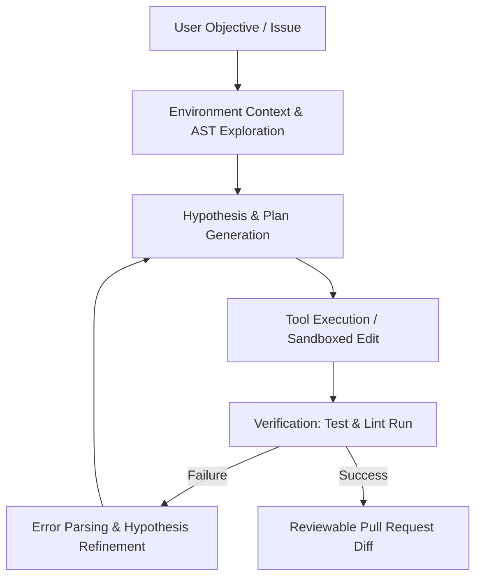

## The Paradigm Shift in Engineering

For the past three years, AI in software development has predominantly taken the shape of inline code completion—helpful tab suggestions predicting the next ten tokens. But in 2026, we have crossed a fundamental threshold into **Agentic Software Engineering**.

Instead of merely completing our lines, autonomous agents now act as tireless junior and mid-level pair programmers: reading repositories, reproducing unit test failures, synthesizing multi-file diffs, and verifying solutions inside secure sandboxes before presenting them for human code review.

> "The true superpower of agentic systems isn't raw generation speed; it is the iterative feedback loop—the ability to inspect errors, test hypotheses, and self-correct."

## Anatomy of a Modern Coding Agent Loop

An autonomous coding agent is not a magic prompt. Under the hood, it is an orchestrator managing a continuous State Machine:



### 1. The Environment Observer
The agent inspects file trees, reads documentation, and builds a working mental model of project boundaries. Tools like language server protocols (LSP) and grep trees prevent context-window explosion by indexing symbols on demand.

### 2. Guarded Tool Calling
Rather than granting arbitrary execution access, modern architectures isolate the agent within an isolated sandbox. Operations are split into standard bounded filesystem writes and sandboxed test executions:

```typescript
export interface AgentToolCall {
  toolName: 'read_file' | 'edit_file' | 'run_command';
  parameters: Record<string, unknown>;
  requiresApproval: boolean;
  timeoutMs: number;
}

export async function executeAgentStep(call: AgentToolCall): Promise<ToolResult> {
  // Validate safety boundaries before executing
  if (call.toolName === 'run_command' && isDangerousCommand(call.parameters)) {
    return { status: 'rejected', reason: 'Unsafe command shape' };
  }
  return await dispatchToSandbox(call);
}
```

### 3. The Self-Correction Loop
When a unit test fails or compilation breaks, the stack trace feeds directly back into the planner. The model updates its trajectory, modifies only the failing lines, and reruns the check.

## What Human Engineers Must Master Now

With routine boilerplate, API integration, and test suite generation increasingly automated, the high-leverage skills for software engineers are shifting:

1. **System Topology & Boundary Definition**: Designing modular components with unambiguous contracts that agents can safely operate within.
2. **Deterministic Verification Suites**: If your test suite is flaky, an agent will either loop indefinitely or write tests that assert false positives. Solid test coverage is now the primary steering wheel for AI.
3. **Domain Modeling & Edge Case Anticipation**: Identifying subtle business invariants and security boundaries that models lack contextual history to infer.

## Looking Forward

We are not entering a future where software engineers are obsolete. We are entering an era where a single architect, equipped with well-orchestrated agent swarms, can conceive, prototype, and ship platforms that formerly required twenty engineers.

The craft is evolving—and it has never been more exciting.
